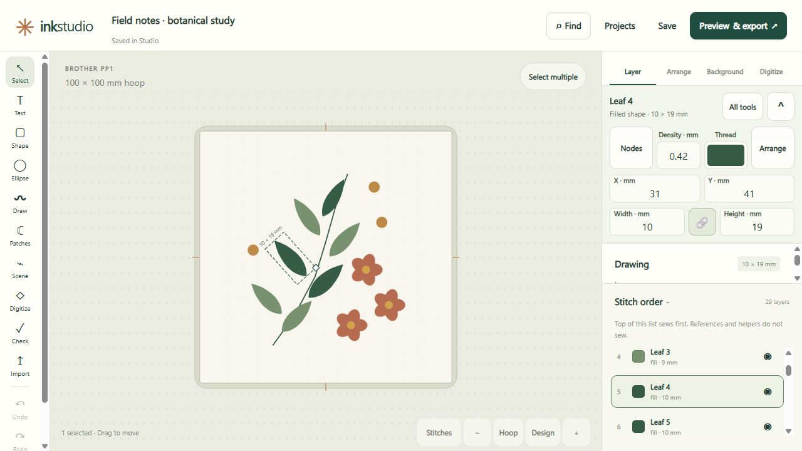
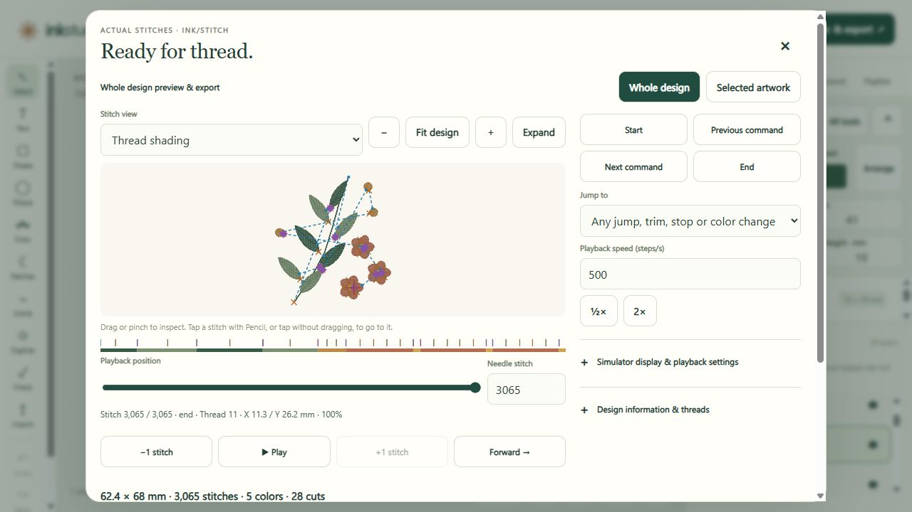

# Ink Studio

A free, open-source embroidery design companion for [Inkscape](https://inkscape.org/)
and [Ink/Stitch](https://inkstitch.org/). Ink Studio runs on your computer and opens
its editor in your web browser.

**[Download Ink Studio 0.1.3](https://github.com/deadman96385/ink-studio/releases/tag/v0.1.3)**
· [Installation](#installation)

**[Explore the visual tour](https://deadman96385.github.io/ink-studio/)** before
installing: screenshots of the editor, stitch simulator, and an exported PDF
worksheet, plus an interactive replay of a real stitch export. The
[showcase guide](docs/README.md) explains how to preview or maintain the site.

  
  

## Features

- Draw and edit embroidery designs, import SVG artwork, and trace images.
- Add lettering and work with embroidery fonts and thread palettes.
- Preview stitches, check designs, and export PES and other embroidery formats.
- Create PDF worksheets and save editable project backups.

## Downloads

Get the packages from the [GitHub release](https://github.com/deadman96385/ink-studio/releases/tag/v0.1.3).
The Windows packages are unsigned previews.

| Package | Download |
| --- | --- |
| Windows x64 installer | [InkStudio-0.1.3-windows-x64-setup.exe](https://github.com/deadman96385/ink-studio/releases/download/v0.1.3/InkStudio-0.1.3-windows-x64-setup.exe) |
| Windows x64 portable | [InkStudio-0.1.3-windows-x64-portable.zip](https://github.com/deadman96385/ink-studio/releases/download/v0.1.3/InkStudio-0.1.3-windows-x64-portable.zip) |
| Matching application source (including Linux) | [InkStudio-0.1.3-source.tar.gz](https://github.com/deadman96385/ink-studio/releases/download/v0.1.3/InkStudio-0.1.3-source.tar.gz) |
| Third-party dependency sources | [InkStudio-0.1.3-third-party-sources.zip](https://github.com/deadman96385/ink-studio/releases/download/v0.1.3/InkStudio-0.1.3-third-party-sources.zip) |

[SHA-256 checksums](https://github.com/deadman96385/ink-studio/releases/download/v0.1.3/SHA256SUMS.txt)
and the [release manifest](https://github.com/deadman96385/ink-studio/releases/download/v0.1.3/release-manifest.json)
are included with the release. See the [Linux setup guide](packaging/README.md#linux)
to run from source.

## Requirements

- **Ink/Stitch 3.3.0** and an Inkscape installation.
- A modern web browser.
- **Windows:** 64-bit Windows 10 (1809 or later) or Windows 11. Application
  dependencies are included in the installer and portable package.
- **Linux:** runs from source with the dependencies in the
  [Linux setup guide](packaging/README.md#linux).

## Installation

### Windows

1. Install Inkscape and [Ink/Stitch](https://inkstitch.org/docs/install-windows/)
   if they are not already installed.
2. Choose an installer or portable ZIP from [Downloads](#downloads). Run the
   installer, or extract the portable ZIP to a writable folder and run
   `Ink Studio.exe`.
3. Open Ink Studio and follow **Setup and Diagnostics** to check your tools
   and choose where to save projects.

Setup can prepare a private Inkscape copy if your installed version lacks image
tracing. See the [installation guide](packaging/INSTALL.txt) for offline setup,
upgrades, backups, and troubleshooting.

### Linux

Follow the [Linux setup guide](packaging/README.md#linux) for native installation,
launch commands, and optional container deployment.

## Documentation

- [Installation and troubleshooting](packaging/INSTALL.txt)
- [Building from source](packaging/README.md)
- [Changelog](CHANGELOG.md)
- [Contributing](CONTRIBUTING.md)
- [Privacy](PRIVACY.md) and [Code signing policy](CODE_SIGNING_POLICY.md)

## License

Ink Studio is an independent companion to Inkscape and Ink/Stitch, licensed under
**GPL-3.0-or-later**. See [LICENSE](LICENSE) and [third-party notices](NOTICE.txt).
